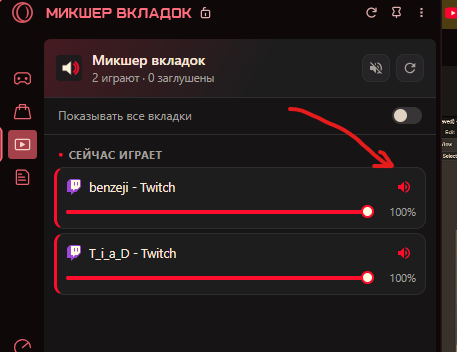

# 🎛️ Browser Tab Audio Mixer for Opera GX

  <b>Управление громкостью и отключением звука каждой вкладки прямо из боковой панели Opera GX</b> 
  <b>Control volume and mute individual tabs directly from the Opera GX sidebar</b>

 

  <b>Переключение языка / Switch language:</b> 
  
  

---

<h2>🇷🇺 Русская версия / Russian Tab (нажмите, чтобы свернуть/развернуть)</h2>

### 📸 Внешний вид

  

---

### ⚡ Быстрая установка (готовый билд без сборки)

Вам **не нужно** ничего компилировать, собирать или настраивать. Устанавливается за 30 секунд:

1. **Скачайте последний готовый билд:**  
   👉 [**Скачать BrowserTabAudioMixer.zip (Latest Release)**](https://github.com/Mmitekk/BrowserTabAudioMixer/releases/latest/download/BrowserTabAudioMixer.zip)  
   *(или со страницы [Все релизы](https://github.com/Mmitekk/BrowserTabAudioMixer/releases/latest))*

2. **Распакуйте архив** в любую постоянную папку на компьютере (например, `C:\Extensions\BrowserTabAudioMixer`).

3. **Включите в браузере Opera GX:**
   - Откройте в адресной строке: `opera://extensions`
   - В правом верхнем углу включите тумблер **«Режим разработчика»** (Developer mode).
   - Нажмите появившуюся кнопку **«Загрузить распакованное расширение»** (Load unpacked).
   - Выберите распакованную папку.

🎉 **Готово!** Иконка микшера появится на левой боковой панели Opera GX (рядом со значками Twitch, Discord и мессенджеров).

---

### ✨ Возможности

- 🎧 **Интеграция в боковую панель Opera GX (`sidebar_action`):** открывается как удобный виджет слева в один клик.
- 🎚️ **Точная двусторонняя синхронизация громкости:**
  - **Twitch:** прямая синхронизация с внутренним плеером Amazon IVS и DOM-ползунком `[data-a-target="player-volume-slider"]` через нативный сеттер React. Громкость микшера и плеера на Twitch всегда совпадает!
  - **YouTube:** полноценная интеграция с YouTube Player API (`movie_player`).
  - **HTML5 (VK, RuTube, Spotify, SoundCloud, Кинопоиск и др.):** универсальное управление медиа-элементами, включая вложенный Shadow DOM.
- 🔇 **Умное отключение звука (Mute):** нажатие на кнопку динамика **не переключает активную вкладку** и не сбивает фокус в Opera GX.
- ⚡ **Мастер-кнопки в шапке:**
  - Кнопка заглушить/включить все играющие вкладки разом.
  - Кнопка сброса громкости всех вкладок на 100%.
  - Кнопка мгновенной перезагрузки панели `⟳`.
- 👁️ **Фильтр вкладок:** переключатель «Показывать все вкладки» позволяет настраивать громкость даже тех вкладок, на которых звук временно на паузе.
- 🎨 **Оригинальный стиль Opera GX:** стильная тёмная тема (`#111218`) с неоновыми красными акцентами (`#ff1b2d`).

---

### 🔄 Обновление до новой версии

1. Скачайте свежий `.zip` из [Releases](https://github.com/Mmitekk/BrowserTabAudioMixer/releases/latest).
2. Распакуйте с заменой файлов в ту же папку.
3. На странице `opera://extensions` нажмите кнопку обновления `⟳` на карточке расширения. Браузер перезагружать не нужно!

---

<h2>🇬🇧 English Version / English Tab (click to expand/collapse)</h2>

### 📸 Preview

  

---

### ⚡ Quick Installation (Ready-to-use Build)

You **do not** need to build, compile, or install any developer tools. Setup takes 30 seconds:

1. **Download the latest release build:**  
   👉 [**Download BrowserTabAudioMixer.zip (Latest Release)**](https://github.com/Mmitekk/BrowserTabAudioMixer/releases/latest/download/BrowserTabAudioMixer.zip)  
   *(or check the [Releases page](https://github.com/Mmitekk/BrowserTabAudioMixer/releases/latest))*

2. **Unpack the archive** into any permanent folder on your computer (e.g. `C:\Extensions\BrowserTabAudioMixer`).

3. **Install into Opera GX:**
   - In Opera GX address bar, navigate to: `opera://extensions`
   - Enable the **"Developer mode"** toggle in the top-right corner.
   - Click the **"Load unpacked"** button.
   - Select the unzipped folder.

🎉 **All done!** The mixer icon will appear directly in your Opera GX left sidebar widget dock!

---

### ✨ Features

- 🎧 **Native Opera GX Sidebar Widget (`sidebar_action`):** docks neatly on the left side alongside Twitch, Discord, and messaging apps.
- 🎚️ **True Two-Way Volume Synchronization:**
  - **Twitch:** direct bidirectional sync with Amazon IVS player and the `[data-a-target="player-volume-slider"]` DOM slider via the React prototype property setter. The mixer slider and Twitch player slider stay completely in sync.
  - **YouTube:** full YouTube Player API integration (`movie_player.getVolume()` / `setVolume()`).
  - **HTML5 (VK, Spotify, SoundCloud, Netflix, etc.):** universal volume control for all audio/video elements across shadow DOM trees.
- 🔇 **Seamless Tab Muting:** toggling mute on background tabs **never jumps or switches tab focus** in Opera GX.
- ⚡ **Header Master Controls:**
  - Mute/unmute all playing tabs with a single click.
  - Reset all tabs volume back to 100%.
  - Quick reload button `⟳`.
- 👁️ **Tab Filter:** "Show all tabs" toggle to manage volume even for tabs currently paused.
- 🎨 **Opera GX Aesthetics:** sleek dark interface (`#111218`) with cyberpunk red accents (`#ff1b2d`).

---

### 🔄 Updating to a Newer Version

1. Download the new `.zip` from [Releases](https://github.com/Mmitekk/BrowserTabAudioMixer/releases/latest).
2. Unpack and replace the files in your existing extension folder.
3. Open `opera://extensions` and click the reload icon `⟳` on the extension card. No browser restart required!

---

Made with ❤️ for Opera GX users • [License: MIT](LICENSE)

